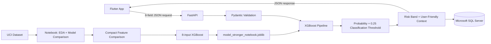

# CreditGuard Architecture

## Runtime architecture

## Selected product model

The current product candidate is a compact XGBoost classifier using eight inputs:

- `LIMIT_BAL`
- `AGE`
- `PAY_0`
- `PAY_2`
- `BILL_AMT1`
- `BILL_AMT2`
- `PAY_AMT1`
- `PAY_AMT2`

The classification threshold is `0.25`, selected during validation to improve the
precision/recall trade-off compared with the default `0.50` threshold.

The UI separately presents demo risk bands:

- `< 0.20` -> Low
- `0.20 to < 0.40` -> Medium
- `>= 0.40` -> High

These bands are presentation labels, not lending policy.

## API boundary

Flutter does not load the model directly. It sends user-friendly JSON fields to
FastAPI. The backend maps those fields into the model feature names, runs
inference, persists prediction history, and returns a user-facing result.

## Explanations

The current response includes contextual signals based on entered values
(repayment status, credit usage, payment size). These are intentionally labeled
as contextual explanations and must not be interpreted as causal XGBoost feature
attributions.

SHAP or another model-attribution method can be added later.

## Database

The MVP uses Microsoft SQL Server and stores prediction history in `predictions`.

| Column | Purpose |
|---|---|
| `id` | Prediction identifier |
| `created_at` | Creation timestamp |
| `model_name` | Model used |
| `model_version` | Model artifact version |
| `default_probability` | Class-1 probability |
| `predicted_default` | Internal class derived from the configured threshold |
| `risk_band` | Low / medium / high presentation band |
| `input_payload` | Original user-facing request JSON |
| `factors_json` | Contextual factors returned by the API |
| `disclaimer` | Educational-use warning |

## Trust boundary

CreditGuard is an educational ML prototype. It intentionally does not perform:

- credit approval or denial
- underwriting
- loan pricing
- eligibility decisions
- autonomous financial actions
- production compliance or fairness certification
