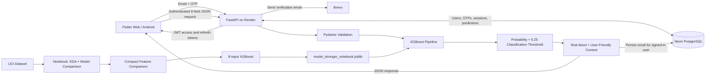

# CreditGuard Architecture

## Runtime architecture

The Flutter Web frontend is hosted on **Cloudflare Workers**. The Android application is distributed as a signed APK. Both use the same HTTPS **FastAPI** service on **Render**. The deployed database is **Neon PostgreSQL**. Local development can instead use **Microsoft SQL Server Express** through SQLAlchemy configuration.

## Selected product model

The current product model is a compact XGBoost classifier using eight inputs:

- `LIMIT_BAL`
- `AGE`
- `PAY_0`
- `PAY_2`
- `BILL_AMT1`
- `BILL_AMT2`
- `PAY_AMT1`
- `PAY_AMT2`

The classification threshold is `0.25`, selected during validation to improve the
precision/recall trade-off compared with the default `0.50` threshold.

The UI separately presents demo risk bands:

- `< 0.20` → Low
- `0.20 to < 0.40` → Medium
- `>= 0.40` → High

These bands are presentation labels, not lending policy. Model output percentages have not been calibrated for real-world probability interpretation.

## API and authentication boundary

Flutter does not load the model or connect directly to the database. It sends user-friendly JSON fields to FastAPI. The backend maps these fields into the model feature names, runs inference, stores the result for the authenticated user, and returns a user-facing response.

Users authenticate by email OTP sent through Brevo. FastAPI validates OTPs, issues short-lived JWT access tokens and rotating refresh tokens, and stores session records in the database. Prediction creation and history retrieval require authentication; history is scoped to the signed-in user.

The Flutter client uses **Bloc** for state management and **Dio** for HTTP requests. Android persists session credentials using its token-storage implementation; the Web client keeps its tokens in application memory, so a page reload can require reauthentication.

## Explanations

The current response includes contextual signals based on entered values
(repayment status, credit usage, payment size). These are intentionally labeled
as contextual explanations and must not be interpreted as causal XGBoost feature
attributions.

SHAP or another model-attribution method is not implemented.

## Database

The deployed application uses **Neon PostgreSQL**. Local development can use **Microsoft SQL Server Express** instead. SQLAlchemy models define these principal tables:

- `users`: email-based user accounts.
- `email_otps`: hashed OTP challenges, expiry, attempts and request timestamps.
- `auth_sessions`: hashed refresh-token records and revocation/expiry details.
- `predictions`: model results, input payloads and per-user history.

The `predictions` table includes:

| Column | Purpose |
|---|---|
| `id` | Prediction identifier |
| `created_at` | Creation timestamp |
| `user_id` | Associated authenticated user |
| `model_name` | Model used |
| `model_version` | Model artifact version |
| `default_probability` | Model class-1 output (not calibrated) |
| `predicted_default` | Internal class derived from the configured threshold |
| `risk_band` | Low / medium / high presentation band |
| `input_payload` | Original user-facing request JSON |
| `factors_json` | Contextual factors returned by the API |
| `disclaimer` | Educational-use warning |

## Deployment

- **Web application:** https://creditguard-web.pritamsarangi70.workers.dev
- **Backend API:** https://creditguard-api-0izj.onrender.com
- **API documentation:** https://creditguard-api-0izj.onrender.com/docs
- **Database:** Neon PostgreSQL (connection credentials are private)
- **Email delivery:** Brevo

Render's free instance can be slow on its first request after idle time. The OTP endpoint has an email cooldown and basic hourly limits, but these limits are not comprehensive abuse prevention or concurrency-proof. Web refresh tokens remain accessible to JavaScript while the page is active; the project has not undergone a production security audit.

## Trust boundary

CreditGuard is an educational ML prototype. It intentionally does not perform:

- credit approval or denial
- underwriting
- loan pricing
- eligibility decisions
- autonomous financial actions
- production compliance or fairness certification

Do not use its scores to make actual lending or credit decisions.
